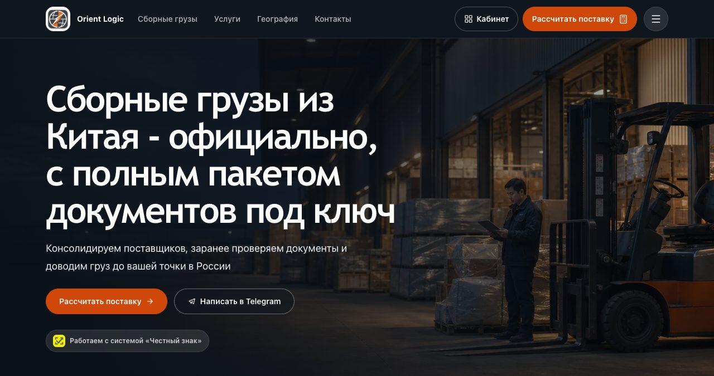

<!-- Generated by node scripts/build.mjs from content/profile.mjs. -->

# Ilia Larionov | Илья Ларионов ‣ DevLarion

**Independent full-stack developer and founder of DevLarion**

I build web products, apps and bots. I use AI to automate routine work on client projects and in my own products.

[Русский](README.ru.md) · [Portfolio site](https://luvlarion4ik.github.io/luvlarion4ik/) · [Contact Me](https://t.me/luvlarion4ik_bot?start=contact_en)

## Selected work

### Orient Logic

**Main project · Commercial partnership**

Website and inquiry flow for a freight company operating between China and Russia. I took the site from requirements to implementation, built the responsive Next.js frontend and connected inquiries to Telegram.

`Next.js` `TypeScript` `Tailwind CSS` `Telegram`

[Open live site](https://orientlogic.ru/)

### Reshis Avia

**Competition project · Technology track**

An airline pricing tool that uses a demand forecast to estimate sales and compare fares. I analyzed demand in Python notebooks and built a FastAPI app that shows demand quantiles, aircraft capacity and expected sales at different prices.

`Python` `Machine learning` `FastAPI` `Chart.js`

## In development

- **Wrist AI** · Preparing for an App Store release. My AI assistant for Apple Watch. Ask a question and read the answer on the watch.

Read the case study · Wrist AI

**Why I started it**. I kept reaching for my iPhone when I wanted a quick AI answer while wearing my Apple Watch. I hadn’t found an assistant I liked using directly on the watch, so I started building one around a simple flow: ask, read the answer, get back to what you were doing.

**What I built**. The SwiftUI watch app has a question field for typing or dictation, a choice of response modes, and recently asked questions. I also built an iPhone companion with Apple sign-in and a larger screen for chat.

**How it works**. The watch sends the question and the selected mode to a FastAPI backend. I built the server-side routing so short questions can use a quick mode and harder questions can use a reasoning mode. The project includes tests for authentication and model routing.

**What comes next**. I’m preparing the commercial release. I plan to verify the watch and iPhone flow on devices, run a TestFlight beta, and submit Wrist AI to the App Store for review.

- **City Technologies** · B2G / B2C · In development. A city services platform for the Yamalo-Nenets Autonomous Okrug (YNAO), with a resident-facing MAX Mini App and workspaces for operators and providers.

Read the case study · City Technologies

**For residents**. The resident-facing app brings the service catalog, request submission and status history together. Delivery scenarios also have a courier bot.

**For operators and service providers**. The service app has a request queue, separate roles for operators and partners, assignment by service type and area, and a view for tracking progress. The B2G side is designed around coordinating requests and the organizations that fulfill them.

**Status**. The development version includes the interfaces and request workflows. Maps and payments are currently simulated.

- **Larion Keyway** · Beta testing. My macOS adaptation of Magerko’s open-source Copilot. I added a macOS platform layer, keyboard-first controls and tests for the new workflows. [Upstream project by Magerko · MIT](https://github.com/Magerko/copilot).

- **Cognivue** · MVP in development. A platform for evaluating how an audience may respond to websites, interfaces, advertising and video before launch.

- **Axenta** · Telegram demo in development. A personalized AI tutor for students, with a level assessment and support for notes and photos of notebooks.

## DevLarion studio

I lead projects from requirements and prototypes to development and launch. The studio builds websites, web apps, CRMs, bots for Telegram, MAX, VK and WhatsApp, Mini Apps and AI integrations.

`TypeScript` `Next.js` `Python` `FastAPI` `SwiftUI` `Serverless` `AI integrations`

## Milestones

- **[DANO 2026–27 finalist](https://dano.hse.ru/)** · Qualified through the second selection round and preparing for the individual and team rounds of the National Data Analysis Olympiad.
- **[Artek IT program selection prizewinner](https://cu.ru/events/bachelor-artek)** · Reached the final selection stage in the Central University and T-Bank competition, prepared a business case and presented my own project.
- **[Central University education grant](https://apply.cu.ru/)** · Received an education grant through competitive selection.
- **All-Russian School Olympiad in Mathematics** · Advanced to the regional stage.

Other competition projects

- **Mirror of Probabilities · T-Bank and Central University** · Worked through the service infrastructure, product metrics, risks and options for scaling.

## Get in touch

Send a project brief or proposal through the contact form in my Telegram bot.

[Contact Me](https://t.me/luvlarion4ik_bot?start=contact_en) · The Telegram contact form is being set up.

[Share profile](https://luvlarion4ik.github.io/luvlarion4ik/)
