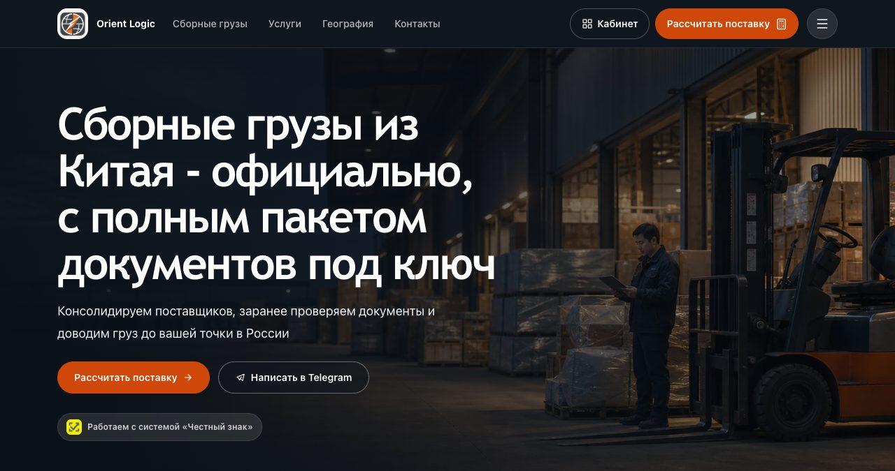

<!-- Generated by node scripts/build.mjs from content/profile.mjs. -->

# Ilia Larionov | Илья Ларионов ‣ DevLarion

**Независимый full-stack разработчик и основатель DevLarion**

Разрабатываю веб-продукты, приложения и ботов. В студии веду коммерческие проекты, а в собственных продуктах проверяю, где ИИ упрощает повседневные задачи.

[English](README.md) · [Сайт-портфолио](https://luvlarion4ik.github.io/luvlarion4ik/ru/) · [Написать в Telegram](https://t.me/LuvLarion4ik)

## Избранные работы

### Orient Logic

**Основной проект · Коммерческое партнёрство**

Сайт и приём заявок для компании, которая возит грузы из Китая в Россию. Вёл проект от сбора требований до реализации, собрал адаптивный фронтенд на Next.js и подключил отправку заявок в Telegram.

`Next.js` `TypeScript` `Tailwind CSS` `Telegram`

[Открыть сайт](https://orientlogic.ru/)

### «Решись Авиа»

**Конкурсный проект · Направление «Технологии»**

Инструмент для ценообразования авиабилетов с прогнозом спроса и оценкой продаж при разных тарифах. Проанализировал спрос в Python-ноутбуках и собрал приложение на FastAPI, которое показывает квантили спроса, вместимость самолёта и ожидаемые продажи при разных ценах.

`Python` `Машинное обучение` `FastAPI` `Chart.js`

## В разработке

- **Wrist AI** · Подготовка к выпуску в App Store. Мой AI-помощник для Apple Watch. Можно задать вопрос и прочитать ответ прямо на часах.

Подробнее о проекте · Wrist AI

**Почему я начал разработку**. Я ношу Apple Watch, но за быстрым ответом от ИИ всё равно приходилось тянуться за iPhone. Я не нашёл ассистента, которым мне было бы удобно пользоваться на часах, и решил сделать свой. Хотелось, чтобы на ходу можно было задать вопрос, прочитать ответ и вернуться к делу.

**Что я сделал**. Собрал watchOS-приложение на SwiftUI. В нём можно набрать или надиктовать вопрос, выбрать режим ответа и открыть недавние запросы. Сделал приложение-компаньон для iPhone со входом через Apple и чатом для задач, где удобнее экран побольше.

**Как устроен сервис**. Часы передают вопрос и выбранный режим на сервер FastAPI. Я вынес выбор модели на сервер: короткий вопрос можно отправить в быстрый режим, а сложную задачу — в режим рассуждения. В проекте есть тесты авторизации и маршрутизации запросов.

**План выпуска**. Готовлю приложение к коммерческому запуску. Дальше хочу проверить связку часов и iPhone на устройствах, провести бета-тестирование через TestFlight и отправить Wrist AI на проверку для публикации в App Store.

- **Технологии города** · B2G / B2C · В разработке. Платформа городских услуг для ЯНАО с мини-приложением MAX для жителей и рабочими кабинетами для операторов и исполнителей.

Подробнее о проекте · Технологии города

**Для жителей**. В клиентском мини-приложении есть каталог услуг, подача заявки и история её статусов. Для сценариев доставки предусмотрен отдельный бот курьера.

**Для операторов и поставщиков услуг**. В рабочем мини-приложении есть очередь заявок, отдельные роли оператора и партнёра, назначение исполнителей по типу услуги и зоне и отслеживание выполнения. B2G-часть рассчитана на координацию заявок и организаций, которые их выполняют.

**Текущий статус**. В разработке уже есть интерфейсы и сценарии работы с заявками. Карта и оплата пока работают в режиме симуляции.

- **Larion Keyway** · Бета-тестирование. Моя адаптация открытого Copilot от Magerko для macOS. Добавил платформенный слой, управление с клавиатуры и тесты новых сценариев. [Оригинал Magerko · MIT](https://github.com/Magerko/copilot).

- **Cognivue** · MVP в разработке. Платформа для предварительной оценки реакции аудитории на сайты, интерфейсы, рекламу и видео.

- **Аксента** · Telegram-демо в разработке. Персонализированный AI-репетитор с диагностикой уровня и работой с конспектами и фотографиями тетрадей.

## Студия DevLarion

Веду проекты от постановки задачи и прототипирования до разработки и запуска. Студия создаёт сайты, веб-приложения, CRM, ботов для Telegram, MAX, VK и WhatsApp, Mini Apps и интеграции с ИИ.

`TypeScript` `Next.js` `Python` `FastAPI` `SwiftUI` `Serverless` `AI integrations`

## Достижения

- **[Финалист ДАНО 2026/27](https://dano.hse.ru/)** · Прошёл второй отборочный этап Национальной олимпиады по анализу данных. Готовлюсь к индивидуальному и командному турам заключительного этапа.
- **[Призёр отбора на ИТ-смену в «Артеке»](https://cu.ru/events/bachelor-artek)** · Прошёл финальный этап конкурса Центрального университета и Т-Банка, подготовил бизнес-кейс и представил собственный проект.
- **[Образовательный грант Центрального университета](https://apply.cu.ru/)** · Получил грант по результатам конкурсного отбора.
- **Всероссийская олимпиада школьников по математике** · Вышел в региональный этап.

Другие конкурсные проекты

- **«Зеркало вероятностей» · Т-Банк и ЦУ** · Проработал инфраструктуру сервиса, продуктовые метрики, риски и варианты масштабирования.

## Связаться со мной

Напиши мне в Telegram — обсудим проект или сотрудничество.

[Написать в Telegram](https://t.me/LuvLarion4ik)

[Поделиться профилем](https://luvlarion4ik.github.io/luvlarion4ik/ru/)
